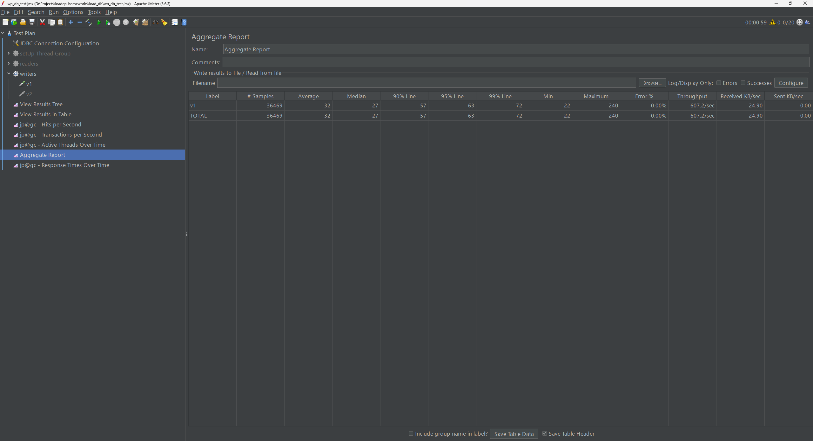
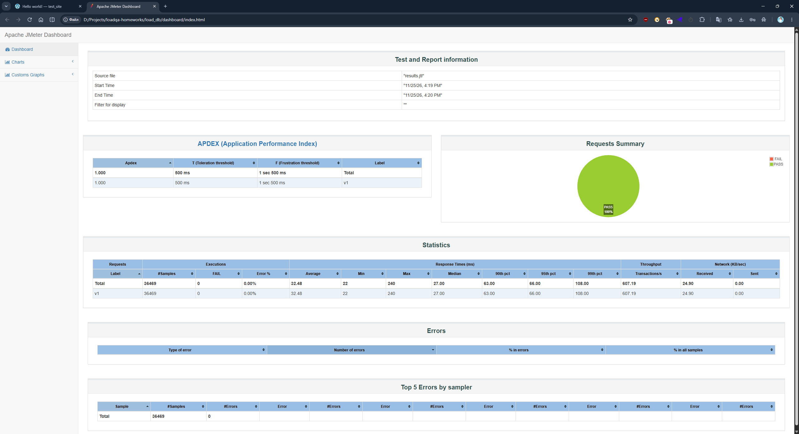
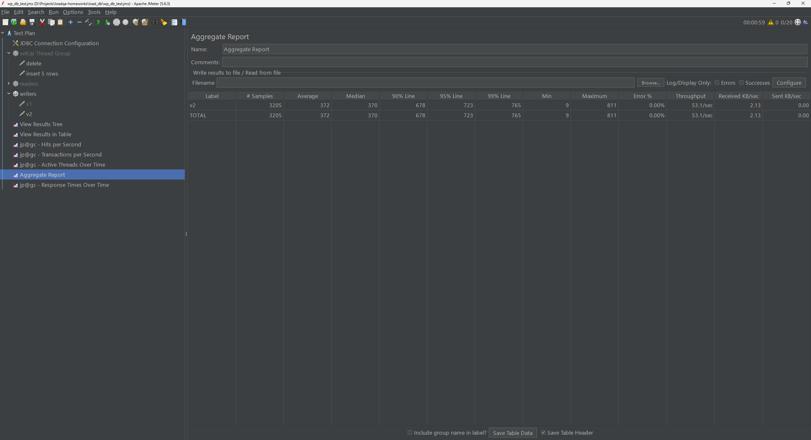
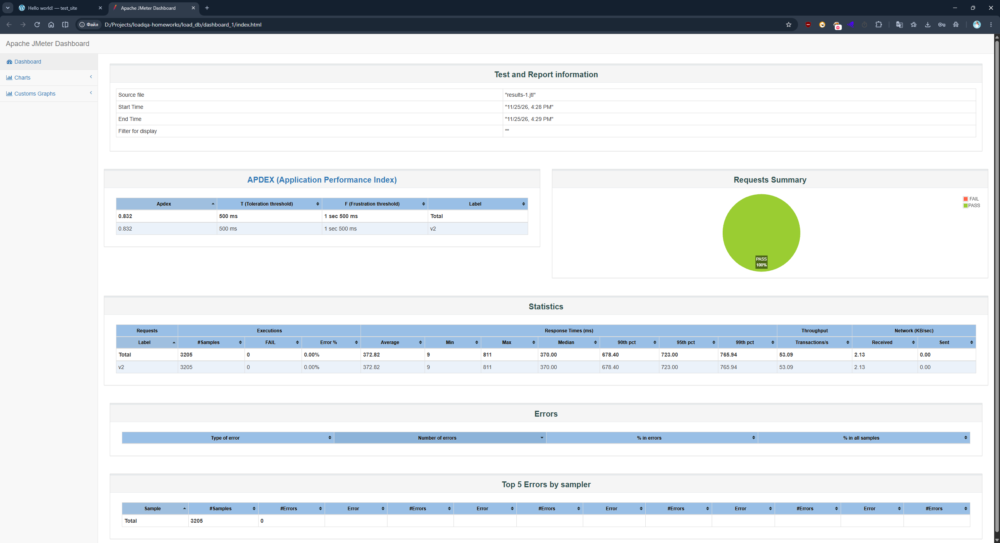

# Протокол нагрузочного тестирования хранимых процедур

## 1. Общая информация

**Дата проведения испытаний:** 25 ноября 2026 года  
**Тестируемая система:** локальный сайт WordPress с базой данных MariaDB в Docker.

**Используемые инструменты:**
- DBeaver — подключение к MariaDB, выполнение SQL-скриптов и создание хранимых процедур.
- Apache JMeter 5.6.3 — проведение нагрузочного тестирования и сбор результатов.
- Java 17 — среда выполнения JMeter.

## 2. Цель испытаний

Сравнить производительность двух вариантов хранимой процедуры добавления комментариев в таблицу `wp_comments`.

Проверяемая гипотеза: процедура `dorepeat_v1`, использующая запрос для получения `@post_id` из таблицы `wp_posts`, выполняется быстрее процедуры `dorepeat_v2`, использующей `GROUP BY` и `HAVING COUNT()` для получения `@post_id` из таблицы `wp_comments`.

## 3. Предварительные условия

Перед началом испытаний:

1. Запущены контейнеры Docker с тестовым приложением WordPress и базой данных MariaDB.
2. С помощью DBeaver выполнено подключение к MariaDB.
3. В DBeaver выполнены SQL-скрипты создания хранимых процедур `dorepeat_v1` и `dorepeat_v2`.
4. Проверена работоспособность созданных процедур.
5. Подготовлен тестовый план JMeter с JDBC Request для вызова каждой процедуры.
6. Настроены отдельные сценарии нагрузочного тестирования для V1 и V2.

## 4. Средства и условия проведения испытаний

- Операционная система: Windows 11.
- СУБД: MariaDB.
- Среда запуска приложения и базы данных: Docker.
- Приложение: WordPress.
- Клиент для работы с базой данных: DBeaver.
- Apache JMeter: 5.6.3.
- Java: 17.

Профиль нагрузки для обоих испытаний:

| Параметр | Значение |
|---|---:|
| Количество потоков | 20 |
| Ramp-up period | 1 секунда |
| Loop Count | Infinite |
| Same user on each iteration | Включено |
| Specify Thread lifetime | Включено |
| Duration | 60 секунд |

## 5. Методика проведения испытаний

Подготовка хранимых процедур выполнялась в DBeaver. Нагрузочные испытания проводились с помощью Apache JMeter.

Каждый вариант процедуры тестировался отдельным запуском JMeter.

### 5.1. Испытание процедуры V1

В JDBC Request использовался вызов:

```sql
CALL dorepeat_v1(10);
```

При каждом вызове процедура выполняла 10 итераций внутреннего цикла `REPEAT`.

Порядок выполнения:

1. Запустить тестовый план JMeter с настроенным профилем нагрузки.
2. Выполнить вызов `dorepeat_v1(10)` из JDBC Request.
3. Провести нагрузочное тестирование в течение 60 секунд.
4. Зафиксировать результаты выполнения запросов.
5. Сформировать Aggregate Report и HTML Dashboard.
6. Сохранить графики результатов испытания.

### 5.2. Испытание процедуры V2

В JDBC Request использовался вызов:

```sql
CALL dorepeat_v2(3, '_комментарий');
```

При каждом вызове процедура выполняла 3 итерации внутреннего цикла `REPEAT`.

Порядок выполнения:

1. Запустить тестовый план JMeter с тем же профилем нагрузки.
2. Выполнить вызов `dorepeat_v2(3, '_комментарий')` из JDBC Request.
3. Провести нагрузочное тестирование в течение 60 секунд.
4. Зафиксировать результаты выполнения запросов.
5. Сформировать Aggregate Report и HTML Dashboard.
6. Сохранить графики результатов испытания.

## 6. Результаты испытаний

### 6.1. Процедура V1

| Показатель | Результат |
|---|---:|
| Samples | 36 469 |
| Average, мс | 32 |
| Median, мс | 27 |
| 90% Line, мс | 57 |
| 95% Line, мс | 63 |
| 99% Line, мс | 72 |
| Min, мс | 22 |
| Maximum, мс | 240 |
| Error % | 0,00% |
| Throughput, запросов/с | 607,2 |
| Received KB/sec | 24,90 |
| Sent KB/sec | 0,00 |

**Результат:** запросы завершились без зарегистрированных ошибок. Процедура показала среднее время ответа 32 мс и пропускную способность 607,2 запроса/с.

### 6.2. Процедура V2

| Показатель | Результат |
|---|---:|
| Samples | 3 205 |
| Average, мс | 372 |
| Median, мс | 370 |
| 90% Line, мс | 678 |
| 95% Line, мс | 723 |
| 99% Line, мс | 765 |
| Min, мс | 9 |
| Maximum, мс | 811 |
| Error % | 0,00% |
| Throughput, запросов/с | 53,1 |
| Received KB/sec | 2,13 |
| Sent KB/sec | 0,00 |

**Результат:** запросы завершились без зарегистрированных ошибок. Процедура показала среднее время ответа 372 мс и пропускную способность 53,1 запроса/с.

## 7. Сравнительный результат

В ходе испытаний процедура V1 показала более высокую производительность по сравнению с V2:

- Среднее время ответа V1 — 32 мс, V2 — 372 мс.
- Пропускная способность V1 — 607,2 запроса/с, V2 — 53,1 запроса/с.
- Количество зарегистрированных запросов V1 — 36 469, V2 — 3 205.
- Процент ошибок в обоих испытаниях — 0,00%.

При этом V1 выполняла 10 итераций внутреннего цикла за один вызов, а V2 — 3 итерации.

## 8. Приложения

### 8.1. Результаты испытания V1

**Aggregate Report**



**Графики JMeter**

- [Hits per Second](screenshots/dbrepeat_v1/Hits_per_Second_v1.png)
- [Transactions per Second](screenshots/dbrepeat_v1/Transactions_per_Second_v1.png)
- [Active Threads Over Time](screenshots/dbrepeat_v1/Active_Threads_Over_Time_v1.png)
- [Response Times Over Time](screenshots/dbrepeat_v1/Response_Times_Over_Time_v1.png)

**HTML Dashboard**



### 8.2. Результаты испытания V2

**Aggregate Report**



**Графики JMeter**

- [Hits per Second](screenshots/dbrepeat_v2/Hits_per_Second_v2.png)
- [Transactions per Second](screenshots/dbrepeat_v2/Transactions_per_Second_v2.png)
- [Active Threads Over Time](screenshots/dbrepeat_v2/Active_Threads_Over_Time_v2.png)
- [Response Times Over Time](screenshots/dbrepeat_v2/Response_Times_Over_Time_v2.png)

**HTML Dashboard**



## 9. Заключение

Оба испытания завершились без зарегистрированных ошибок выполнения запросов.

По результатам сравнительного тестирования процедура `dorepeat_v1` показала существенно более высокую производительность, чем `dorepeat_v2`, несмотря на большее количество итераций внутреннего цикла за один вызов.

Проверяемая гипотеза о преимуществе V1 подтвердилась в рамках использованного тестового стенда и заданного профиля нагрузки.

При этом для отдельной оценки влияния запросов получения `@post_id` необходимо провести дополнительное сравнение процедур при одинаковых параметрах и одинаковой логике формирования комментариев.