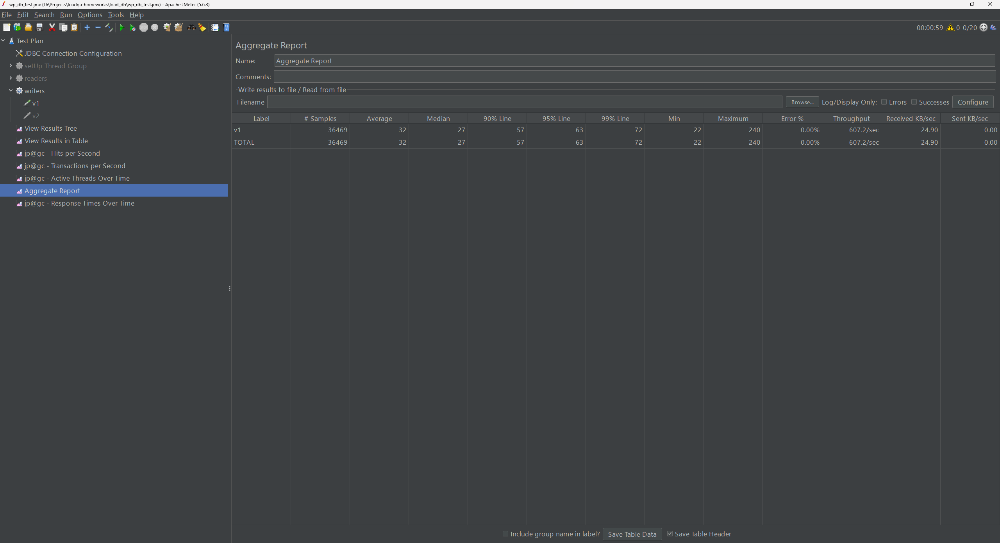
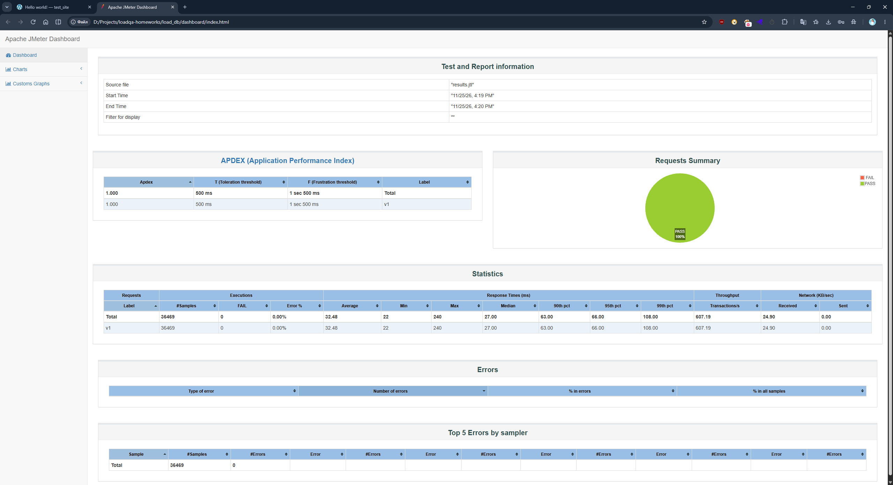
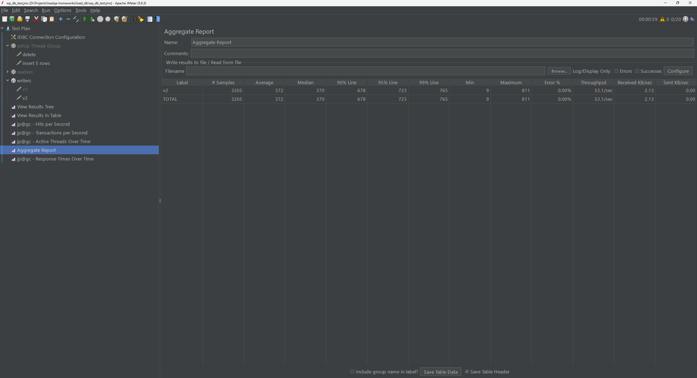
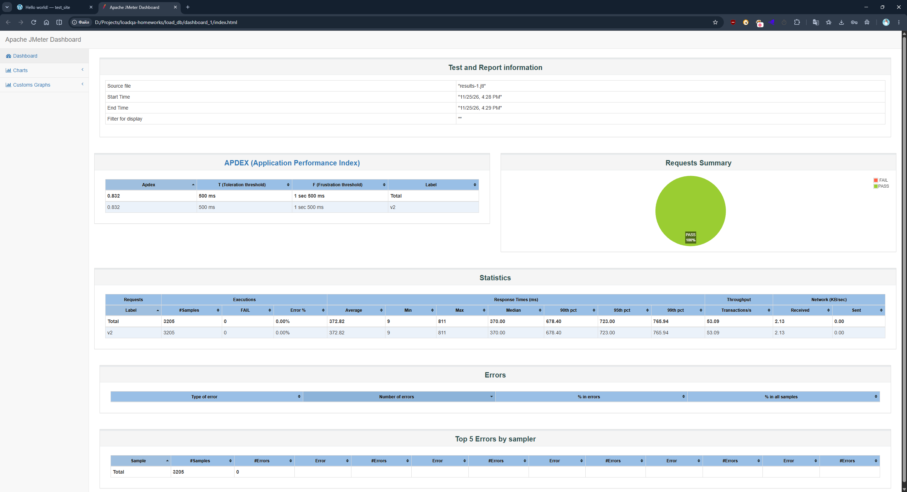

# Отчёт о нагрузочном тестировании хранимых процедур

## 1. Общая информация

**Дата проведения испытаний:** 25 ноября 2026 года  
**Тестируемая система:** локальный сайт WordPress с базой данных MariaDB, запущенные в Docker.

**Используемые инструменты:**
- DBeaver — подключение к MariaDB, выполнение SQL-скриптов, создание и проверка хранимых процедур.
- Apache JMeter 5.6.3 — проведение нагрузочного тестирования и сбор результатов.
- Java 17 — среда выполнения JMeter.

## 2. Цель тестирования

Цель испытаний — сравнить производительность двух вариантов хранимой процедуры, добавляющей комментарии в таблицу `wp_comments`, и проверить гипотезу о том, что процедура `dorepeat_v1` выполняется быстрее `dorepeat_v2`.

Основное различие между вариантами заключается в запросе, используемом для получения значения `@post_id`.

**Вариант V1:**

```sql
SET @post_id = (
    SELECT id
    FROM wp_posts
    ORDER BY id ASC
    LIMIT 1
);
```

**Вариант V2:**

```sql
SET @post_id = (
    SELECT comment_post_ID
    FROM wp_comments
    GROUP BY comment_content
    HAVING COUNT(comment_content) >= 3
    LIMIT 1
);
```

Предполагалось, что более сложная операция группировки и подсчёта записей в V2 может привести к увеличению времени выполнения процедуры.

## 3. Конфигурация тестового стенда

- Операционная система: Windows 11.
- Среда запуска приложения и базы данных: Docker.
- Система управления базами данных: MariaDB.
- Тестируемое приложение: WordPress.
- Клиент для работы с базой данных: DBeaver.
- Инструмент нагрузочного тестирования: Apache JMeter 5.6.3.
- Версия Java: 17.

DBeaver использовался для подключения к MariaDB, выполнения SQL-скриптов создания хранимых процедур и проверки их работы.

Apache JMeter использовался для многократного вызова хранимых процедур под нагрузкой, регистрации результатов и формирования отчётов.

Тестирование проводилось на локальном стенде.

## 4. Описание сравниваемых процедур

Обе процедуры добавляют записи в таблицу `wp_comments` с использованием внутреннего цикла `REPEAT`.

### Процедура dorepeat_v1

- Получает `@post_id` из таблицы `wp_posts` с помощью `ORDER BY id ASC LIMIT 1`.
- Формирует содержимое комментария с постоянным значением `comment`.
- Количество итераций внутреннего цикла определяется параметром `p1`.

Вызов процедуры в JMeter:

```sql
CALL dorepeat_v1(10);
```

За один вызов выполняется 10 итераций внутреннего цикла.

### Процедура dorepeat_v2

- Получает `@post_id` из таблицы `wp_comments` с использованием `GROUP BY` и `HAVING COUNT(comment_content) >= 3`.
- Формирует содержимое комментария с помощью `CONCAT(@x, p2)`.
- Количество итераций внутреннего цикла определяется параметром `p1`.

Вызов процедуры в JMeter:

```sql
CALL dorepeat_v2(3, '_комментарий');
```

За один вызов выполняется 3 итерации внутреннего цикла.

Таким образом, процедуры различаются не только способом получения `@post_id`, но и формированием содержимого комментариев.

## 5. Сценарий и профиль нагрузки

Для обеих процедур использовалась одинаковая конфигурация Thread Group в JMeter:

| Параметр | Значение |
|---|---:|
| Number of Threads (users) | 20 |
| Ramp-up period | 1 секунда |
| Loop Count | Infinite |
| Same user on each iteration | Включено |
| Specify Thread lifetime | Включено |
| Duration | 60 секунд |

Каждый вариант процедуры тестировался отдельным запуском JMeter.

Вызовы процедур в JDBC Request:

- V1: `CALL dorepeat_v1(10);`
- V2: `CALL dorepeat_v2(3, '_комментарий');`

JMeter повторял сценарий в течение 60 секунд. При каждом вызове процедуры параметр `p1` определял количество итераций внутреннего цикла `REPEAT`.

## 6. Результаты тестирования

### 6.1. Результаты процедуры V1

По результатам Aggregate Report:

| Показатель | Значение |
|---|---:|
| Samples | 36 469 |
| Average, мс | 32 |
| Median, мс | 27 |
| 90% Line, мс | 57 |
| 95% Line, мс | 63 |
| 99% Line, мс | 72 |
| Min, мс | 22 |
| Maximum, мс | 240 |
| Error % | 0,00% |
| Throughput, запросов/с | 607,2 |
| Received KB/sec | 24,90 |
| Sent KB/sec | 0,00 |

Скриншот Aggregate Report:



Графики:

- [Hits per Second](screenshots/dbrepeat_v1/Hits_per_Second_v1.png)
- [Transactions per Second](screenshots/dbrepeat_v1/Transactions_per_Second_v1.png)
- [Active Threads Over Time](screenshots/dbrepeat_v1/Active_Threads_Over_Time_v1.png)
- [Response Times Over Time](screenshots/dbrepeat_v1/Response_Times_Over_Time_v1.png)

HTML Dashboard:



### 6.2. Результаты процедуры V2

По результатам Aggregate Report:

| Показатель | Значение |
|---|---:|
| Samples | 3 205 |
| Average, мс | 372 |
| Median, мс | 370 |
| 90% Line, мс | 678 |
| 95% Line, мс | 723 |
| 99% Line, мс | 765 |
| Min, мс | 9 |
| Maximum, мс | 811 |
| Error % | 0,00% |
| Throughput, запросов/с | 53,1 |
| Received KB/sec | 2,13 |
| Sent KB/sec | 0,00 |

Скриншот Aggregate Report:



Графики:

- [Hits per Second](screenshots/dbrepeat_v2/Hits_per_Second_v2.png)
- [Transactions per Second](screenshots/dbrepeat_v2/Transactions_per_Second_v2.png)
- [Active Threads Over Time](screenshots/dbrepeat_v2/Active_Threads_Over_Time_v2.png)
- [Response Times Over Time](screenshots/dbrepeat_v2/Response_Times_Over_Time_v2.png)

HTML Dashboard:



## 7. Сравнение результатов

| Показатель | V1 | V2 |
|---|---:|---:|
| Samples | 36 469 | 3 205 |
| Average, мс | 32 | 372 |
| Median, мс | 27 | 370 |
| 90% Line, мс | 57 | 678 |
| 95% Line, мс | 63 | 723 |
| 99% Line, мс | 72 | 765 |
| Min, мс | 22 | 9 |
| Maximum, мс | 240 | 811 |
| Error % | 0,00% | 0,00% |
| Throughput, запросов/с | 607,2 | 53,1 |

Основные наблюдения:

- Количество зарегистрированных запросов V1 примерно в 11,38 раза больше, чем V2.
- Пропускная способность V1 примерно в 11,43 раза выше.
- Среднее время ответа V2 примерно в 11,63 раза больше, чем V1.
- Медианное время ответа V2 примерно в 13,70 раза больше.
- 95-й перцентиль времени ответа V2 примерно в 11,48 раза больше.

При этом за один вызов V1 выполняет 10 итераций внутреннего цикла, а V2 — 3. Следовательно, V1 выполняет примерно в 3,33 раза больше итераций за один вызов процедуры.

В обоих испытаниях процент ошибок составил 0,00%.

## 8. Анализ результатов

Результаты нагрузочного тестирования показывают существенное преимущество процедуры V1 по времени ответа и пропускной способности.

Несмотря на то что V1 за один вызов выполняет больше итераций внутреннего цикла, она демонстрирует значительно меньшее среднее и медианное время ответа, а также более высокую пропускную способность.

Одним из возможных объяснений разницы является способ получения значения `@post_id`.

В V1 используется запрос к таблице `wp_posts` с сортировкой и ограничением результата. В V2 выполняется группировка записей таблицы `wp_comments` и подсчёт количества значений `comment_content` с использованием `HAVING`.

Следует учитывать, что процедуры также отличаются способом формирования содержимого комментария. Поэтому результаты позволяют сравнить производительность двух вариантов в целом, но не дают возможности определить точный вклад каждого отдельного SQL-оператора.

## 9. Найденные дефекты

В ходе проведённых нагрузочных испытаний ошибок выполнения запросов не зарегистрировано. Показатель Error % для обоих вариантов составил 0,00%.

Функциональные дефекты приложения в рамках данного нагрузочного тестирования отдельно не проверялись.

## 10. Ограничения тестирования

- Испытания проводились на локальном стенде.
- Сравнивались два варианта процедуры с разными параметрами внутреннего цикла: 10 итераций для V1 и 3 итерации для V2.
- Процедуры различаются не только запросом получения `@post_id`, но и способом формирования содержимого комментария.
- Тестирование не включало отдельное исследование загрузки CPU, оперативной памяти и других ресурсов хоста.
- Результаты характеризуют производительность в рамках использованного стенда, сценария и профиля нагрузки.

## 11. Выводы

По результатам проведённых испытаний гипотеза о более высокой производительности `dorepeat_v1` подтвердилась.

Процедура V1 показала среднее время ответа 32 мс и пропускную способность 607,2 запроса/с. Для V2 соответствующие показатели составили 372 мс и 53,1 запроса/с.

Таким образом, в рамках проведённого эксперимента V1 продемонстрировала примерно в 11,6 раза меньшее среднее время ответа и в 11,4 раза большую пропускную способность.

Особенно показательно, что V1 выполняла 10 итераций внутреннего цикла за один вызов, тогда как V2 — только 3, но при этом V1 сохранила значительное преимущество по основным показателям производительности.

Результаты подтверждают преимущество V1 в условиях проведённого тестирования. Для точного определения влияния именно запроса получения `@post_id` необходимо дополнительное сравнение при одинаковых параметрах и одинаковой логике формирования записей.